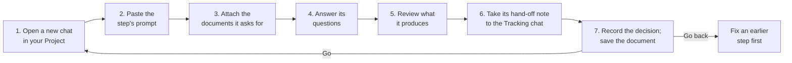

# Building Your Own App

## Executive Summary

This guide walks you through building your own app with the AI-assisted
SDLC workflow, from the first idea to real people using it. It follows the
same ten steps as the sample project, BeautifulBeachPark Volunteers, and
at every step it points you to the sample file to compare with your own.
Everything is built, tested, and shown to your stakeholders **on your own
computer, at no cost**. Only after they approve it does it move to live
servers, usually ones your organization already has.

Keep this guide open alongside the step guides (b01 to b10). The step
guides explain each step; this guide says what to do for **your**
project.

---

## Introduction

Throughout this guide, the example is **OurGroupVolunteerApp**, a
volunteer sign-up app for a community group. Use your own project's name
wherever you see it. Your app doesn't have to be a volunteer app; the
steps are the same for any small web app, but the volunteer example makes
it easy to compare your work with the sample's.

**Think of it like building from a model home.** The sample is the model
home: finished, furnished, and open for viewing. This guide is the
checklist the builder follows to build *your* house, room by room. You can
walk next door to the model home at any time to see how a room should
look, but your house gets your own floor plan, paint colors, and address.

---

## Before You Start

You'll need:

| What | Why | Where it comes from |
|---|---|---|
| The setup from [a08](a08-implementing-an-ai-assisted-sdlc-workflow.md) done | Your project folder, its Claude Project, its GitHub repo, and Claude's access to your files | a08, Steps 1 to 6 |
| One or two **stakeholders** | The people who approve each step, such as your group's leader and whoever runs your volunteers. It can be just you, but a second person catches more. | Your group |
| Your organization's **website address** | Step 5 makes your app's screens match your website's look | Your website |
| Who runs your organization's **web servers**, if anyone | Step 6 asks what their rules are, and Step 9 moves the app onto their servers | Your IT team, web host, or the person who looks after your website |
| **Claude Code** | Steps 6 to 10 run commands in your project folder: setting up, testing, building | [a08](a08-implementing-an-ai-assisted-sdlc-workflow.md), Step 5 |

You don't need to know how to program. You do need to read what each chat
produces and decide whether it is right. That is your job in every step.

---

## How Every Step Works

Every step follows the same loop. Once you've done it twice, it becomes
routine.

1. **Open a new chat** in your project's Claude Project, and name it after
   the step, for example `03-requirements`.
2. **Paste the step's prompt** from the [`prompts/`](../prompts/) folder
   (c01 to c10), or attach the file and say "Please follow this prompt."
3. **Attach the documents** listed at the top of the prompt, under "How to
   Use This Prompt." Usually that's your tracking checklist plus the
   approved documents from earlier steps.
4. **Answer its questions.** Each chat asks everything it needs in one
   numbered list. "Don't know yet" is a fine answer; it will mark the gap
   for later.
5. **Review what it produces.** Open the matching sample document
   side by side, and check that yours covers the same ground for your
   project. Ask for changes until you're happy.
6. **Take the hand-off note to the Tracking chat** (the Step 1 chat, which
   stays open the whole time). It checks the work and asks you, as the
   stakeholder, for a decision: Go, Go back, Park, or Abandon.
7. **Save the document** in your project's `docs/` folder, named after its
   template (for example, `docs/d03-01-prd.md`), and commit it to GitHub
   (with GitHub Desktop: type a summary, click **Commit to main**, then
   **Push origin**).

**When a chat says an earlier document must change** (a "go-back"), take
its request to that earlier step's chat, get the revised document approved
in the Tracking chat, and then return. The sample's go-back is in Step 4:
text-message reminders were moved to a later phase because they cost
money for every message.

---

## The Ten Steps

Each section says what to give the chat, what you get back, which sample
file to compare with, and how you know you're done.

### Step 1: Tracking

**Guide:** [b01](b01-tracking.md) · **Prompt:** `c01-tracking-prompt.md` ·
**Sample:** [`d01-01-checklist.md`](../samples/BeautifulBeachParkVolunteers/docs/d01-01-checklist.md)

- **Give it:** your project's name, a sentence about what it's for, your
  stakeholders, and any deadline.
- **You get:** your tracking checklist, `d01-01`. Medium projects also get
  a status table; long ones a timeline.
- **You're done when:** the checklist lists all ten steps and its Next
  Action points to Step 2.
- **Remember:** keep this chat. You come back to it after **every** step.

### Step 2: Feasibility

**Guide:** [b02](b02-feasibility.md) · **Prompt:** `c02-feasibility-prompt.md` ·
**Sample:** [`d02-01-one-pager.md`](../samples/BeautifulBeachParkVolunteers/docs/d02-01-one-pager.md)

- **Give it:** your group's real problem, in your own words. For example:
  "Our coordinators spend hours on email chains filling Saturday shifts,
  and volunteers' email addresses get passed around."
- **You get:** a one-page summary with a go/no-go recommendation, or, for
  a bigger project, a feasibility study.
- **You're done when:** the stakeholders record a Go in the Tracking chat.
- **Watch for:** solving a problem your group doesn't have. If the
  one-pager describes the sample's park instead of your group, push back.

### Step 3: Requirements

**Guide:** [b03](b03-requirements.md) · **Prompt:** `c03-requirements-prompt.md` ·
**Sample:** [`d03-01-prd.md`](../samples/BeautifulBeachParkVolunteers/docs/d03-01-prd.md)

- **Give it:** the approved one-pager, and who will use the app.
- **You get:** the Product Requirements Document (PRD): your users, and a
  **use case** for each thing they need to do.
- **Decide here:** which of the sample's features you keep. The sample has
  seven use cases (post a task, create an account, sign up, cancel, view a
  roster, message a volunteer, block a volunteer). A smaller group may not
  need messaging or blocking; another may need something the sample
  doesn't have, such as recurring weekly shifts.
- **You're done when:** every use case has acceptance criteria you could
  check by hand, and the PRD has a Go.
- **Watch for:** "nice to have" features creeping in. Each one adds tests,
  code, and upkeep. Put them in a later phase.

### Step 4: Design

**Guide:** [b04](b04-design.md) · **Prompt:** `c04-design-prompt.md` ·
**Sample:** [`d04-01-spec.md`](../samples/BeautifulBeachParkVolunteers/docs/d04-01-spec.md)

- **Give it:** the approved PRD.
- **You get:** the Software Design Specification (Spec): how the app will
  work, a sequence diagram for every use case, and a Security & Compliance
  section that says how personal information is protected.
- **You're done when:** you can follow each sequence diagram from start to
  finish, and the Spec has a Go.
- **Watch for:** the Architect choosing something expensive or complicated.
  Ask "What's the simplest design that meets the PRD?"

### Step 5: User Experience

**Guide:** [b05](b05-user-experience.md) · **Prompt:** `c05-user-experience-prompt.md` ·
**Sample:** [`d05-01-ui-ux.md`](../samples/BeautifulBeachParkVolunteers/docs/d05-01-ui-ux.md),
[`d05-02-style-guide.md`](../samples/BeautifulBeachParkVolunteers/docs/d05-02-style-guide.md),
[`assets/mockups/`](../samples/BeautifulBeachParkVolunteers/assets/mockups/)

- **Give it:** the PRD, the Spec, and **your website's address** (or
  screenshots of it) plus your logo, so the screens look like they belong
  to your organization.
- **You get:** the UI/UX Document (every screen, every message's exact
  wording), a Style Guide with your colors and fonts, and mockups: pictures
  of each screen you can open in a browser.
- **You're done when:** you've opened every mockup, read every message
  aloud, and the stakeholders approve the look.
- **Watch for:** wording. The tests in Step 7 check messages word for word,
  so this is the cheapest moment to get them right.

### Step 6: Initial Infrastructure

**Guide:** [b06](b06-infrastructure.md) · **Prompt:** `c06-initial-infrastructure-prompt.md` ·
**Sample:** [`d06-01-infrastructure.md`](../samples/BeautifulBeachParkVolunteers/docs/d06-01-infrastructure.md),
[`d06-02`](../samples/BeautifulBeachParkVolunteers/docs/d06-02-infrastructure-options.md),
[`d06-03`](../samples/BeautifulBeachParkVolunteers/docs/d06-03-cost-sign-off.md)

This step decides **where the app will go live**, but sets up only the
free **local environment** on your computer. The live servers wait for
Step 9.

- **Give it:** the PRD, Spec, and UI/UX Document, and what you know about
  your organization's servers.
- **If someone runs servers for your organization,** the DevOps chat
  drafts questions for them. Expect questions like these, and send them
  early, because answers and approvals can take weeks:
  - Can our app go on your servers, and who approves it?
  - Which programming language versions and database types do you
    support?
  - How do you install new software, and how are settings and passwords
    given to it?
  - How do apps send email?
  - Can an app run a scheduled job once a day?
  - What web address would it have, and who provides the HTTPS
    certificate?
- **If there are no servers,** it compares new options, such as a small
  cloud hosting plan or a spare computer in the office, with their costs.
- **You get:** the System Infrastructure Document, including the **live
  server requirements** your code must fit; an options comparison; a
  **Cost Sign-Off Sheet** for the stakeholders (still needed even if going
  live costs nothing new); and the local environment, set up by Claude
  Code.
- **You're done when:** the cost sign-off and the final sign-off are both
  recorded, and Claude Code shows you the local environment working.

### Step 7: Test Creation

**Guide:** [b07](b07-test-creation.md) · **Prompt:** `c07-test-creation-prompt.md` ·
**Sample:** [`d07-01-test-plan.md`](../samples/BeautifulBeachParkVolunteers/docs/d07-01-test-plan.md),
[`tests/`](../samples/BeautifulBeachParkVolunteers/tests/)

Run this step in **Claude Code**, in your project folder, because it
writes and runs real tests.

- **Give it:** everything approved so far.
- **You get:** a Test Plan (every test, in plain language, linked to the
  use case it checks), the automated tests in `tests/`, and a Test Results
  Log.
- **You're done when:** every test **fails for the right reason**: the
  app doesn't exist yet. A test that fails for another reason, such as a
  typo, must be fixed now. The sample's first run is the model: 36 tests
  failed with "No module named bbpv," and 2 were blocked until a browser
  tool was installed.
- **Watch for:** tests with no use case behind them, or use cases with no
  tests. The Test Plan's traceability table should cover both.

### Step 8: Implementation

**Guide:** [b08](b08-implementation.md) · **Prompts:** `c08-01-implementation-prompt.md`, `c08-02-code-review-prompt.md`, `c08-03-hands-on-review-prompt.md`, `c08-04-polishing-prompt.md` ·
**Sample:** [`d08-01-implementation-record.md`](../samples/BeautifulBeachParkVolunteers/docs/d08-01-implementation-record.md),
[`d08-02-developer-guide.md`](../samples/BeautifulBeachParkVolunteers/docs/d08-02-developer-guide.md),
[`d08-04-code-review-codex.md`](../samples/BeautifulBeachParkVolunteers/docs/d08-04-code-review-codex.md),
[`src/`](../samples/BeautifulBeachParkVolunteers/src/)

Also in **Claude Code**. The Software Engineer chat builds until every
test passes. The tests are **locked**: if it thinks a test is wrong, it
asks the SDET chat, which decides.

- **You get:** working code in `src/`, an Implementation Record, a
  Developer Guide (how to set up, run, test, and install the app), and
  draft Release Notes.
- **Then, three independent reviews, one after another.** You don't need
  to read code. Each review is a **round**: read the report (each starts
  with a "How to Read This Report" box), write your **Decision** on each
  finding (Fix, Accept as is, or Ask), get the fixes made, and have the
  same reviewer check them. Only then start the next round.
  1. **Round 1: a different company's AI reviews the code.** With
     [Codex](https://developers.openai.com/codex/cli) installed and
     signed in, ask Claude Code: "Run Codex in read-only mode with the
     c08-02 prompt, and save its final answer, word for word, as
     `docs/d08-04-code-review-codex.md`." Claude Code must only pass the
     prompt along and save the answer, never edit it. No Codex? Use a new
     Claude Code session instead.
  2. **Round 2: a new Claude Code session reviews the improved code.**
     Open Claude Code in your project folder as a **new session** (not
     the one that built the code, and not round 1's) and say: "Please
     follow `prompts/c08-02-code-review-prompt.md` from the
     ai_assisted_sdlc_workflow repo, and run `/security-review` first."
     It saves `docs/d08-04-code-review-claude.md`.
  3. **Polishing: you use the app first.** When round 2 is settled, open
     Claude Code in your project folder and say: "Please follow
     `prompts/c08-04-polishing-prompt.md`." It starts the app and
     suggests what to try. Whenever something feels wrong ("I can't pick
     8:00 a.m."; "I can't remove a task"), say so: it tells you whether
     that's how it was designed, offers options, and makes the change you
     choose through the documents, tests, and code. Keep it to an hour or
     two. It records everything in `docs/d08-06-polishing-log.md`. Then a
     new Claude Code session reviews just the polishing changes (prompt
     c08-02, Mode E).
  4. **Round 3: a person uses the app** (a hands-on review). Anyone can
     do it, including you or another stakeholder, but it's best done by
     someone like your real users who didn't build it. Start a chat with
     prompt c08-03: it writes their **session plan** (how to start the
     app on a computer, and tasks to try). They work through it, explore
     freely to try to break it, and note anything wrong, confusing, or
     slow; then the same chat turns their notes into
     `docs/d08-05-hands-on-review.md`. They may look at the code, but
     don't have to.
  5. **Rework, in every round.** Each "Fix" goes back to where the
     problem starts: a **bug** to the SDET chat (a test) and then the
     Software Engineer chat; a **usability** problem to the UI/UX chat
     first (Step 5), then the tests and code; a **missing requirement** to
     the Requirements chat (Step 3). Then every test runs again, and the
     round's reviewer checks the changes (a code reviewer reviews them;
     the person re-checks what they found). Repeat until every finding of
     the round is settled. **A round ends when no Must-fix finding is left
     open;** after that, new Should-fix findings go on a Future Version
     list unless you choose Fix.
- **You're done when:** every test passes, every screen matches its
  mockup, the code fits the live server requirements from Step 6, and all
  three review rounds are done, in order, with polishing before round 3,
  and a decision on every finding
  and every fix re-checked. If a professional
  developer can also look at the code, especially for an app that stores
  personal information, even better.
- **Watch for:** the AI adding features nobody asked for, or changing a
  test to make it pass. Both should go back through the right chat.

> **Shortcut: if your app does the same thing as the sample.** If your
> group needs a volunteer sign-up app much like BeautifulBeachPark's, you
> can start Steps 7 and 8 from the sample instead of from nothing. Still do
> Steps 1 to 6 for your own group: the tests and code must trace back to
> **your** PRD, Spec, and screens. Then, in Claude Code, ask: "Copy
> `samples/BeautifulBeachParkVolunteers/tests` and `src` into my project."
> In Step 7, ask the SDET chat to compare the copied tests with your Test
> Plan and change them to match your use cases and wording. In Step 8, ask
> the Software Engineer chat to change the code until your tests pass,
> including your colors, your organization's name in the pages, and your
> messages. You save time, but you still review everything, and the app
> still gets its three independent reviews.

### Step 9: Release

**Guide:** [b09](b09-release.md) · **Prompt:** `c09-release-prompt.md` ·
**Sample:** [`d09-01-release-plan.md`](../samples/BeautifulBeachParkVolunteers/docs/d09-01-release-plan.md),
[`d09-02`](../samples/BeautifulBeachParkVolunteers/docs/d09-02-release-readiness-review.md),
[`d09-03`](../samples/BeautifulBeachParkVolunteers/docs/d09-03-release-efficacy.md)

Step 9 has four stages. Each one ends with something approved before the
next begins.

1. **Stakeholder demo, on your computer.** Start the app the way your
   Developer Guide says (in the sample: `flask --app bbpv seed-demo`, then
   `flask --app bbpv run`). Let each stakeholder try it with made-up
   accounts, following a short script of the main use cases. Emails go to
   a pretend inbox, so nothing reaches a real person. Record their
   approval in the Tracking chat, or the changes they ask for. Changes go
   back to the right step, and nothing has been moved yet, so they cost
   nothing.
2. **Move to the live servers.** Give the people who run your servers the
   Developer Guide's install steps. They install the app, connect the real
   email service, and then the **same automated tests** are run on their
   servers. Every test passing there proves the move worked.
3. **Private pilot.** A few trusted people use test accounts for a week
   or so. Nothing is announced. This is when the stress test (many
   pretend users at once) and the manual checks (such as "do reminder
   emails land in the inbox, not spam?") happen. In the sample, the stress
   test found a connection limit, fixed with one setting.
4. **Go live.** The Release Manager checks every hard-stop rule in the
   Release Readiness Review and recommends Go or No-Go. The stakeholders
   decide. Then the test accounts are removed and real users are invited.

- **You're done when:** the watch period after going live ends, and the
  Release Efficacy Document says how it went.
- **Watch for:** pressure to skip a rule because a newsletter or event date
  is coming. The sample's Readiness Review shows a No-Go under exactly that
  pressure, and how it was resolved.

### Step 10: Maintenance

**Guide:** [b10](b10-maintenance.md) · **Prompt:** `c10-maintenance-prompt.md` ·
**Sample:** [`d10-01-maintenance-log.md`](../samples/BeautifulBeachParkVolunteers/docs/d10-01-maintenance-log.md),
[`d10-02`](../samples/BeautifulBeachParkVolunteers/docs/d10-02-maintenance-status-report.md),
[`d10-03`](../samples/BeautifulBeachParkVolunteers/docs/d10-03-next-phase-or-sunset.md)

- **Give it:** the live app's documents, and an update rhythm (monthly is
  typical).
- **You get:** a Maintenance Log, a status report each month, and, when
  the app has outgrown its design or stopped being useful, a
  recommendation to start a new phase or retire it.
- **Remember:** every update runs the full test suite on your computer
  first, then again on the live servers. Bugs get a test before they get
  a fix.

---

## When Things Go Wrong

| Situation | What to do |
|---|---|
| A chat says an earlier document must change | Take its request to that step's chat, get the revision approved in the Tracking chat, then come back. This is normal; the sample has several. |
| A test seems wrong in Step 8 | The Software Engineer chat asks the SDET chat. The SDET decides, and records any change and its reason in the Test Plan. The sample's Step 8 had two such requests, both accepted, because the tests, not the code, were wrong. |
| Stakeholders ask for changes at the demo | Good: that's what the demo is for. Record a Go back to the right step (often 5 or 8), make the change locally, and demo again. |
| The people who run your servers say no, or ask for something new | Return to the Step 6 chat with their answer. It updates the live server requirements, and may send a request to Step 8 if the code must change. |
| A chat gets too long or is lost | Start a new chat with the same prompt and the latest approved documents. Each prompt is written to pick up where the last chat left off. |
| You're stuck | Open the matching sample file. If it doesn't help, ask the Tracking chat for a status report: it lists what's done, what's open, and the next action. |

---

## Checklist

Tick these off in your tracking checklist as you go.

- [ ] Setup from a08 done
- [ ] Step 1: Tracking chat started, checklist created
- [ ] Step 2: Feasibility approved
- [ ] Step 3: PRD approved
- [ ] Step 4: Spec approved
- [ ] Step 5: UI/UX Document, Style Guide, and mockups approved
- [ ] Step 6: Cost sign-off, local environment set up, final sign-off
- [ ] Step 7: Tests written; every test failing for the right reason
- [ ] Step 8: Every test passing; three review rounds done in order (Codex, then Claude Code, then a person's hands-on review), with polishing before the hands-on review and its changes code-reviewed; every finding decided and re-checked
- [ ] Step 9: Demo approved; moved to the live servers; pilot done; live
- [ ] Step 10: Maintenance Log started; first monthly report

---

## Key Takeaways

- Every step is the same loop: new chat, prompt, documents, questions,
  review, Tracking chat, decision.
- Compare your work with the sample at every step.
- Tests come before code, and they're locked once approved.
- Everything happens on your computer, free, until the stakeholders have
  seen the working app and approved it.
- Going live usually means moving onto servers your organization already
  has, following their rules, which you learned in Step 6.

---

**Learn more:**

- [Implementing an AI-Assisted SDLC Workflow](a08-implementing-an-ai-assisted-sdlc-workflow.md):
  the setup this guide starts from
- [BeautifulBeachPark Volunteers](../samples/BeautifulBeachParkVolunteers/README.md):
  the finished sample, which you can run on your own computer
- [Steps, Roles, and Deliverables](a04-steps-roles-and-deliverables.md#where-the-software-lives-local-demo-live):
  why everything happens locally first

**Next:** [Step 1: Tracking](b01-tracking.md) starts your project's first
chat.
