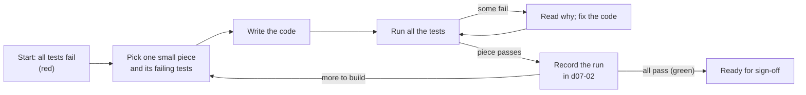
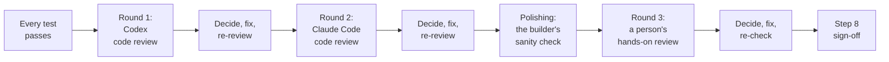
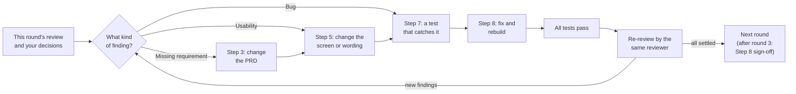

# Step 8: Implementation (The Software Engineer Chat)

**Role:** Software Engineer, then three independent reviewers · **Prompts:** [c08-01](../prompts/c08-01-implementation-prompt.md), [c08-02](../prompts/c08-02-code-review-prompt.md), [c08-03](../prompts/c08-03-hands-on-review-prompt.md), [c08-04](../prompts/c08-04-polishing-prompt.md) · **Templates:** d08-01 to d08-06

> **Building your own app?** See [Building Your Own App, Step 8](a10-building-your-own-app.md#step-8-implementation) for what to do in this step for your project.

## Executive Summary

At the end of [Step 7: Test Creation](b07-test-creation.md), we know
**what** the product must do (the PRD), **how** it will be built (the
Spec), what it will **look like** (the UI/UX Document and Style Guide),
**where** it will run (the System Infrastructure Document), and **exactly
how we will check that it works** (the Test Plan and its automated tests).
Every one of those tests is failing, because nothing has been built yet.
Step 8 builds it.

- **Inputs:** every signed-off document from Steps 3 to 7, the **locked
  automated tests**, the **local environment** and **build-and-test
  pipeline** the DevOps Engineer set up, and the **live server
  requirements** the code must fit.
- **Output:** **working software** that passes every test, the
  **Implementation Record**, a **Developer Guide** that explains the code,
  draft **Release Notes**, and **three independent reviews, one after
  another**: two **Code Review Reports** from AI reviewers that didn't
  write the code, then a short **Polishing** session in which the person
  who built the app runs it and fine-tunes it with the AI (the **Polishing
  Log**), then a **Hands-On Review Report** from people who weren't
  involved, each with a decision on every finding and a re-check of every
  fix before the next stage starts.
- **Hand-off:** once every test passes and the stakeholders sign off, the
  software goes to [Step 9: Release](b09-release.md), where the
  stakeholders try it in a demo on your computer, and only after they
  approve it is it moved to the live servers and put in front of real
  users.

---

## What Is a Software Engineer?

A **Software Engineer**, often called a **programmer** or **developer**,
is the person who writes the instructions that make a computer do
something. Those instructions are called **code**, and they are written in
a **programming language**: a strict, exact language that a computer can
follow. A finished, organized collection of code is a **program** or an
**application** ("app").

Back to the house from [a03](a03-what-is-an-sdlc-workflow.md): the
Architect drew the blueprints, the Designer chose the colors and where the
light switches go, the DevOps Engineer prepared the land and the
utilities, and the SDET wrote the inspection checklist. The Software
Engineer is the **construction crew**. They are the ones who actually
build the house, and they are finished when it passes every inspection.

### What They Do

- **Read the plans** carefully: the PRD, the Spec, the UI/UX Document, and
  the tests.
- **Break the work into small pieces**, and decide the order to build them.
- **Write the code**, one small piece at a time.
- **Run the tests** after every piece, and fix whatever fails.
- **Review** the code for safety, speed, and cost, and have a person review
  it too.
- **Document** the code so the next person (or AI) can understand it.

---

## Inputs, Role, and Outputs

**Inputs.**

| Input | From | What the Software Engineer takes from it |
|---|---|---|
| PRD (`d03-01`) | Step 3 | The use cases: what each user needs to do |
| Spec (`d04-01`) | Step 4 | The components, the data, the requests, the technology, and the Security & Compliance rules |
| UI/UX Document and Style Guide (`d05-01`, `d05-02`) | Step 5 | Every screen, every message's exact wording, colors, fonts, and design files |
| System Infrastructure Document (`d06-01`) | Step 6 | The local environment, the build-and-test pipeline, and the **live server requirements** (Section 5.1) the code must fit |
| Test Plan, Test Results Log, and tests (`d07-01`, `d07-02`, `tests/`) | Step 7 | **The finish line:** every test that must pass |

**The role.** The Software Engineer's work goes in a loop, described
below: build a small piece, run the tests, fix, repeat. Along the way they
never quietly change the plan. If the Spec is missing something, or a test
looks wrong, they send a request back through the
[Tracking chat](b01-tracking.md), just like every other step.

**Outputs.**

| Document | What it contains | Used by |
|---|---|---|
| **Working software** (`src/`) | The code itself | The tests; the Release Manager (Step 9) |
| **Implementation Record** (`d08-01`) | The build plan, progress, tools used, and any requests sent back | Stakeholders (sign-off), Scrum Master |
| **Developer Guide** (`d08-02`) | How the code is organized, and how to set it up, run it, test it, and change it | Step 10, and anyone who works on the code later |
| **Release Notes** (`d08-03`) | What this version does, in plain language, and any known problems | Users, stakeholders, the Release Manager |
| **Code Review Reports** (`d08-04`, one per reviewer) | Findings from two independent AI reviewers, in plain language, with a person's decision on each | The person who decides, the Software Engineer and SDET chats, the Tracking chat |
| **Polishing Log** (`d08-06`) | What the person who built the app noticed while running it, each item's decision, and the documents, tests, and runs that carried each change | The person who decides; the next reviewers' version; the Tracking chat |
| **Hands-On Review Report** (`d08-05`) | What a person found by using the app: tasks tried, ad-hoc testing, usability, each finding with a route back and a decision, and a re-check after rework | The person who decides; the UI/UX, SDET, and Software Engineer chats; the Tracking chat |
| **Test Results Log** (`d07-02`, continued) | A new row for every test run | Scrum Master, SDET |

---

## Built Locally, Ready to Move

All of Step 8 happens on **your own computer**, in the local environment
set up in Step 6. Nothing is put on the live servers yet: that waits until
the stakeholders have seen a demo and approved it in Step 9. But the code
must be **ready to move** there, often onto servers the organization's IT
team already runs. So the Software Engineer follows a few rules that make
moving it a matter of changing settings, not rewriting code:

| Rule | Why |
|---|---|
| **Fit the live server requirements** (d06-01 Section 5.1): the same language version and database type | Code that works only on your computer is not finished |
| **Every setting comes from outside the code**: the database address, the web address, the email service, the secrets | The same code runs locally and on the live servers; only the settings change |
| **No services that exist only on one computer or one provider**, unless the live servers have them too | Moving would mean rewriting that part |
| **Write down how to install and start it** in the Developer Guide (`d08-02`) | The IT team in Step 9 follows these steps |

The same automated tests are run again on the live servers in Step 9,
which proves the move worked.

---

## Tests as Input: Building Until Everything Is Green

This is where **Test-Driven Development (TDD)** pays off. In
[Step 7](b07-test-creation.md), the SDET wrote the answer key before the
exam. In Step 8, the Software Engineer takes the exam, and can check the
answer key as often as they like.

The loop is often called **"red, green, refactor"**: make a failing test
pass (red to green), then tidy the code without breaking anything
(**refactor**), then move on.

This matters most when **AI does the programming**. Ask an AI to "build a
volunteer sign-up app" and it will build *something* and announce it's
done. Give it 38 failing tests and the instruction "make these pass" and
everything changes:

- **The goal is exact.** "Signing up for a full slot shows *Sorry, this
  slot was just taken*" leaves nothing to guess.
- **The AI can check itself.** A tool such as Claude Code can run the
  tests, read exactly which ones failed and why, and fix that piece,
  without a person spotting every mistake.
- **"Done" is a number, not a feeling.** The work is finished at *38 of 38
  passing*, and not before.
- **Old features stay fixed.** Every test runs every time, so building
  piece 9 can't silently break piece 2.

There is one firm rule: **the code changes to pass the tests, never the
other way round.** An AI under pressure may try to "fix" a failing test
instead of the code. The tests are **locked**; only the SDET chat may
change one, with a recorded reason.

---

## UI/UX as Input: Building What Users Actually Want

[Step 5: User Experience](b05-user-experience.md) explained that
programmers are usually not very good at user experience, and showed the
"programmer's sign-up screen": a blinking cursor asking for a task ID and a
date in MM/DD/YYYY format. Left on its own, a Software Engineer, human or
AI, tends to build exactly that: a screen that technically works, or a
generic-looking screen like every other AI-built app.

Giving the Software Engineer the **UI/UX Document**, the **Style Guide**,
and any **design files** (such as Figma files) changes the result. The
engineer builds the Beach Cleanup screen the Designer drew: the photo,
the "2 spots left," the big "Sign up" button, the park's own colors, and
the exact friendly wording. Because the SDET also turned that wording into
tests, the finished screen is *checked* against the design, not just
"inspired by" it. The product ends up looking like what the users and
stakeholders approved, not like the programmer's best guess.

---

## Three Independent Reviews

Passing tests prove the software does what the tests check. They can't
prove there's nothing *else* wrong: a privacy promise the tests didn't
cover, a security hole, code nobody could maintain, or a screen real
people can't figure out. So when every test passes, the app gets **three
independent reviews, one after another**. Each review is a **round**: the
reviewer reports, you decide on every finding, the fixes are made and
tested, and the same reviewer checks the fixes. Only then does the next
round start, on the improved version. None of the reviewers built the
app, and none reads an earlier reviewer's report. This follows the idea
in [The Multi-AI-Agent Paradigm](a02-multi-ai-agent-paradigm.md): no one
should grade their own homework. Between rounds 2 and 3, the person who
built the app also **polishes** it (see below); that isn't an independent
review, so it's the one stage where the builder looks at their own work.

| Round | Who | Looks at | Prompt and report |
|---|---|---|---|
| **1. Codex code review** | A different company's AI tool, such as OpenAI's **Codex** (or, if you don't have one, a **new** Claude Code session) | The code, against the documents | [c08-02](../prompts/c08-02-code-review-prompt.md) → `d08-04-code-review-codex.md` |
| **2. Claude Code code review** | A **new** Claude Code session: not the one that built the code, and not one used in round 1. It also runs Claude Code's built-in `/security-review` | The code, after round 1's fixes | c08-02 → `d08-04-code-review-claude.md` |
| **3. Hands-on review** | **A person**, ideally someone like the app's real users who didn't build it; a stakeholder is fine too | **The running app**, after both code reviews' fixes: scripted tasks, free exploring to try to break it (**ad-hoc testing**), and how easy it is to use. Reading the code is optional. | [c08-03](../prompts/c08-03-hands-on-review-prompt.md) (an AI helper that plans the session and writes up the person's notes) → `d08-05-hands-on-review.md` |

**Why this order:**

- **A different company's AI goes first.** The code was written by one AI,
  and an AI from another company has different blind spots, so it's the
  most likely to find what the builder missed.
- **Each round starts on a better version.** The round 2 reviewer sees
  code that round 1 has already improved, so it spends its effort on new
  problems instead of repeating old ones, and it looks at round 1's fixes
  with fresh eyes.
- **The builder polishes before the person.** The person who built the
  app runs it and fixes the rough edges they can spot in a few minutes
  (see Polishing, below), so round 3's reviewers don't spend their time on
  them.
- **The person goes last.** Their time is the most valuable, so they use
  the version closest to final and don't trip over problems an AI, or the
  builder, could have caught. What they find, the AIs can't: a button nobody finds, a
  word that confuses, a task that takes too many steps.

**Keeping each review independent:** every reviewer reads the approved
documents and the code, but **not** the earlier rounds' reports, and not
the review rows of the Implementation Record (d08-01 Section 7). A later
reviewer will see that the code changed; that's fine, because it reviews
what's there now.

All three reports are written for non-programmers. **You** (or a
stakeholder) read each one when its round comes and decide on every
finding: **Fix**, **Accept as is**, or **Ask**.

### The Rework Loop

Inside each round, a finding marked **Fix** goes back to the step where
the problem really starts, so the documents, tests, and code stay in
agreement:

After the rework, **every test runs again**. Then the reviewer of this
round checks the work: a code reviewer reviews just the **changes** and
each fixed finding (prompt c08-02, Mode E; Codex's `/review` can look at
uncommitted changes or a branch), and the hands-on reviewer **re-checks**
each fixed finding on the new version (prompt c08-03, Mode E). Anything
new goes around the loop again. The next round starts only when every
finding from this round is settled, and Step 8 is signed off after round
3.

**When a round ends.** Each re-review tends to find smaller things than
the last, so without a rule a round could go on and on. The rule: **a
round ends when no Must-fix finding is left open.** After that point, a
new Should-fix finding from a re-review goes on a **Future Version** list
(to be considered in Step 10) unless the person deciding chooses Fix.
Every finding still gets a decision; only the default changes.

### Polishing: the Builder's Sanity Check

Between round 2 and round 3 there's one more stage, and it isn't an
independent review: **Polishing**. The person who built the app (usually
you, the project owner) **runs it**, tries the main task for each role,
and **goes back and forth with the AI** to fine-tune it. Prompt
[c08-04](../prompts/c08-04-polishing-prompt.md) plays the **Polishing
Partner**: it starts the app, suggests what to try, and, whenever you say
something feels wrong, checks the approved documents and tells you
whether it's **working as designed**, a **bug**, or a **gap in the
design**. You decide; every agreed change still goes through the
documents, then a failing test, then the code, then every test. Each item
is recorded in the **Polishing Log** (`d08-06`).

Why bother, when round 3 is coming? Because the builder knows what was
meant, and can spot in minutes what doesn't match it. In the sample
project, the owner's first look found that a coordinator couldn't pick
8:00 a.m. as a start time, and that there was no way to remove a task at
all: two gaps every test and both code reviews had missed, because no
document asked for them. Fixing those first means the round 3 reviewers
spend their time on what only a newcomer can find.

Two rules keep it honest:

- **Time-box it** (an hour or two). Stop when the main tasks feel right,
  not when the app feels perfect; bigger ideas go on the Future Version
  list.
- **Have the polishing changes code-reviewed.** Polishing changes code
  after the code reviews, so when it's done, the round 2 reviewer runs a
  short re-review of just those changes (prompt c08-02, Mode E) before
  round 3 starts. The round 3 reviewers don't read the Polishing Log.

### Running the Reviews

- **Round 1, Codex:** if Codex is installed and signed in, open Claude
  Code in your project folder and ask: "Run Codex in read-only mode with
  the c08-02 prompt, and save its final answer, word for word, as
  `docs/d08-04-code-review-codex.md`." Claude Code only passes along the
  prompt and saves the report; it must never edit or summarize the other
  AI's findings. (The sample also has a `run-codex-review.command` file
  you can double-click in Finder to do the same.) Codex uses your OpenAI
  plan or account, so this is one of the few steps before going live that
  may cost a little; a new Claude Code session is the free alternative.
- **Round 2, Claude Code:** when round 1 is settled, open a **new** Claude
  Code session in your project folder and say: "Please follow
  `prompts/c08-02-code-review-prompt.md` and run `/security-review`
  first."
- **Polishing:** when round 2 is settled, open Claude Code in your
  project folder and say: "Please follow
  `prompts/c08-04-polishing-prompt.md`." Use the app, say what feels
  wrong, decide on each item, and finish with the short code re-review of
  the polishing changes.
- **Round 3, hands-on review:** when polishing is done, start a chat
  with prompt c08-03 to write the person's **session plan** (how to start
  the app, and the tasks to try). The person runs the app on a computer
  with made-up accounts and the pretend inbox, works through the plan,
  explores, and takes notes. The same chat then turns the notes into the
  report. It's the person's review: the helper never coaches them through
  the screens.

**Reviewers aren't perfect.** An AI reviewer can miss a real problem or
report one that isn't there, and one person's experience isn't everyone's.
That's why there are three reviews, why the tests still matter, and why a
person decides. If a professional developer is available, especially for
an app that stores personal information, their review is still worth
having as well.

---

## Why AI Is So Good at Programming

Of all the roles in this workflow, programming is one of the jobs AI does
best. There are several reasons.

**It has seen an enormous amount of code.** AI models learn from huge
amounts of text, and the internet is full of code: millions of open-source
projects, official documentation, tutorials, and question-and-answer sites
where programmers ask "why doesn't this work?" and others answer. Almost
any problem a programmer meets has been solved, explained, and argued
about online many times over, and the AI learned from those examples.

**Code is one of its native languages.** A person thinks in their own
language, such as English. To program, they must first *learn* a computer
language, then *translate* their idea ("only show slots with places left")
into that language's strict rules, and every translation is a chance for a
mistake. An AI learned programming languages the same way it learned
English, from examples, all at once. Python is as natural to it as plain
English, so it can move between your request and the code without the
slow, careful translation a person needs.

**It knows many languages and tools.** There are hundreds of programming
languages, and they differ in important ways:

| Difference | What it means | Examples |
|---|---|---|
| **Compiled ahead of time** | The code is translated into the computer's own instructions *before* it is run. It starts fast and runs fast. | C, C++, Rust, Go, Swift |
| **Translated on the spot** | The code is translated *while* it runs, by a program called an **interpreter** (or a "just-in-time" compiler). Quicker to write and change; often a little slower to run. | Python, JavaScript, Ruby |
| **Specialized for a task** | Built for one kind of work. | R and MATLAB (math and statistics), SQL (asking a database questions) |
| **Aimed at a target** | Languages and frameworks built for one kind of device. | Swift (iPhone apps), Kotlin (Android apps), React Native (one JavaScript codebase for both iPhone and Android) |

A person usually masters a few of these over a career. An AI already
knows most of them, which helps it follow the Architect's choice in the
Spec (Python for the sample project's server) instead of whatever it
happens to know best.

**It knows the best practices from the start.** Every problem can be
solved in many ways, and some ways are far better than others. Finding one
username among 500 by checking each name in turn works, but asking the
database to keep an **index** (like the index at the back of a book) is
much faster. In the cloud, where every second of computer time costs
money (see the [Cost Sign-Off Sheet](b06-infrastructure.md)), faster code
is also cheaper code. The sample Spec has examples: it sends a phone only
the slots that still have places left, and it takes the last place in a
single database step so two volunteers tapping at once can never over-fill
a slot. A seasoned programmer learns patterns like these through years of
trial and error, slow pages, and late-night fixes. An AI knows them from
the very first chat.

**But it still makes mistakes**, sometimes confident, convincing ones.
That is exactly why this workflow writes the tests first, and why a person
still reviews the code before it goes live.

---

## Things to Watch When AI Plays the Software Engineer

| Watch for | What to do |
|---|---|
| **Changing tests to pass.** | The tests are locked. Requests to change one go to the SDET chat. |
| **Building more than was asked.** AI likes to add "helpful" extras. | Build only what the PRD and Spec describe. Extras go to the Product Manager as requests. |
| **Ignoring the design.** | Every screen is built from the UI/UX Document and Style Guide, and checked against its mockup. |
| **Secrets in the code.** | Passwords and keys are never written into the code or pasted into a chat; they stay where d06-01 says. |
| **Code that only runs on your computer.** | Every setting comes from outside the code, and the code fits the live server requirements in d06-01 Section 5.1. |
| **Unknown code libraries.** | Every library is listed in the Developer Guide with its license (Spec Section 11.2). |
| **Grading its own homework.** | Three independent reviews before Step 9, one after another, each with its own fix-and-re-review loop: a code review by a different company's AI, then one by a new Claude Code session (prompt c08-02), then a person's hands-on review of the running app (prompt c08-03). A person decides on every finding, as the Spec's AI-Related Risks section requires. |
| **The builder never using it.** Every test passes, yet a basic control is awkward or something obvious is missing. | Polishing: the person who built the app runs it before anyone else does, and fine-tunes it the workflow's way (prompt c08-04). |
| **Never trying it as a person would.** | The hands-on reviewer uses the app for real, and usability findings go back to Step 5, not straight into the code. |

---

## Prompts, Templates, and Samples

**Prompts** (in `prompts/`):

- [`c08-01-implementation-prompt`](../prompts/c08-01-implementation-prompt.md):
  plays the Software Engineer; reviews every input, plans the build order,
  builds one small piece at a time until every test passes, builds screens
  from the UI/UX Document, reviews security and cost, writes the Developer
  Guide and Release Notes, and prepares the hand-off to Step 9
- [`c08-02-code-review-prompt`](../prompts/c08-02-code-review-prompt.md):
  plays an independent Code Reviewer, in a new Claude Code session or in
  another AI tool such as Codex; checks the code against the documents,
  never changes it, and writes a plain-language Code Review Report; also
  re-reviews the changes after rework
- [`c08-03-hands-on-review-prompt`](../prompts/c08-03-hands-on-review-prompt.md):
  helps a person do the hands-on review: writes the session plan, stays
  out of the way during the session, turns the person's notes into the
  Hands-On Review Report with a route for each finding, and records the
  re-check after rework
- [`c08-04-polishing-prompt`](../prompts/c08-04-polishing-prompt.md):
  plays the Polishing Partner for the person who built the app: starts it,
  suggests what to try, explains "working as designed" versus a bug or a
  gap, makes each agreed change through the documents, tests, and code,
  and keeps the Polishing Log

**Templates** (in `templates/`):

- [`d08-01-implementation-record`](../templates/d08-01-implementation-record.md):
  Implementation Record: build plan, progress, tools, reviews, and requests
  sent back
- [`d08-02-developer-guide`](../templates/d08-02-developer-guide.md):
  Developer Guide: how the code is organized and how to set it up, run,
  test, and change it
- [`d08-03-release-notes`](../templates/d08-03-release-notes.md): Release
  Notes: what this version does, in plain language
- [`d08-04-code-review`](../templates/d08-04-code-review.md): Code Review
  Report: an independent reviewer's findings, each with a seriousness, a
  plain explanation, a next step, and a Decision column for the person
- [`d08-05-hands-on-review`](../templates/d08-05-hands-on-review.md):
  Hands-On Review Report: the session plan, tasks and results, what was
  explored, findings by kind (Bug, Usability, Requirement, Question,
  Praise) with a route back and a Decision column, a usability summary,
  and the re-check after rework
- [`d08-06-polishing-log`](../templates/d08-06-polishing-log.md):
  Polishing Log: how the app was started, what was tried, each item in the
  builder's words with its kind, decision, and the changes and test runs
  that carried it, the questions answered as designed, and the hand-off

**Samples** (in [`samples/BeautifulBeachParkVolunteers/docs/`](../samples/BeautifulBeachParkVolunteers/docs/)):

- [**d08-01**](../samples/BeautifulBeachParkVolunteers/docs/d08-01-implementation-record.md):
  the sample project's Implementation Record, from 0 to 38 of 38 tests
  passing, including two requests to change a test, both accepted because
  the tests, not the code, were wrong
- [**d08-02**](../samples/BeautifulBeachParkVolunteers/docs/d08-02-developer-guide.md):
  the sample's Developer Guide
- [**d08-03**](../samples/BeautifulBeachParkVolunteers/docs/d08-03-release-notes.md):
  the sample's Release Notes for version 1.0
- [**d08-04**](../samples/BeautifulBeachParkVolunteers/docs/d08-04-code-review-codex.md)
  and [**d08-04 (round 2)**](../samples/BeautifulBeachParkVolunteers/docs/d08-04-code-review-claude.md):
  the sample's two Code Review Reports, from Codex and from a new Claude
  Code session, each with its decisions and re-reviews
- [**d08-06**](../samples/BeautifulBeachParkVolunteers/docs/d08-06-polishing-log.md):
  the sample's Polishing Log: the project owner's first look found a
  start-time picker that couldn't reach 8:00 a.m. and no way to remove a
  task, and both were fixed through the documents, tests, and code
- [**d08-05**](../samples/BeautifulBeachParkVolunteers/docs/d08-05-hands-on-review.md):
  the sample's round 3 session plan, ready for people who weren't involved

Additional [case studies](case-studies.md) may be added to this repo at a
future time.

---

**Learn more:**

- [Step 7: Test Creation](b07-test-creation.md): the previous step
- [Step 9: Release](b09-release.md): the next step
- [Step 5: User Experience](b05-user-experience.md): where the screens come from
- [Compiled vs. interpreted languages (Wikipedia: Interpreter)](https://en.wikipedia.org/wiki/Interpreter_(computing)):
  a general introduction
