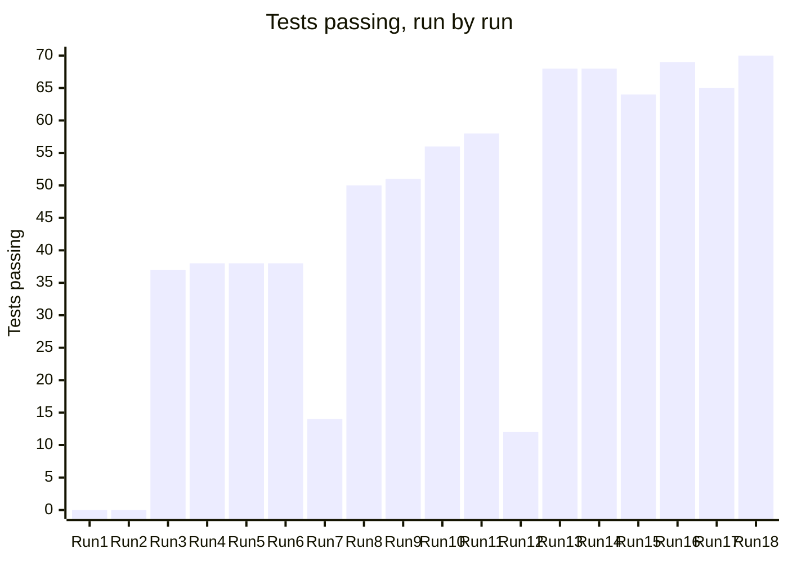

# BeautifulBeachPark Volunteers: Test Results Log

**Document:** d07-02 · **Step:** 7, Test Creation (continued in Steps 8 and 9) · **Version:** 1.6
· **Last updated:** 2026-11-11 · **Status:** Green: all tests pass
· **Owner:** SDET (Test Creation chat); runs added by the Software Engineer (Implementation chat) and the DevOps Engineer

> **Sample document.** The dates and people are made up, but the runs are
> real: the tests in `tests/` and the code in `src/` produced these
> results. Run 1 is the end of Step 7, when nothing was built. Runs 2 to 4
> are Step 8: Claude Code wrote the whole app in one session, and the runs
> found two problems in the **tests**, not the code (Section 6). Runs 5
> and 6 are the same tests on Parks IT's servers in Step 9. Runs 7 to 9
> are the round 1 review fixes (d08-04-code-review-codex.md), run for real
> on 2026-10-25: 13 new tests failed first, then all 51 passed. Run 10 is
> the second pass, after Codex's re-review: 5 more tests, then all 56 passed.

## 1. Overview

| Item | Details |
|---|---|
| Product | BeautifulBeachPark Volunteers |
| Test Plan | d07-01 v1.1 |
| Test environment | Local (made-up data only), d06-01 v1.1 Section 4 |
| Total tests | 38 |
| Latest run | Run 6, 2027-01-15, on Parks IT's servers (Run 4, 2026-12-08, locally) |
| Latest result | 38 pass, 0 fail, 0 blocked |

## 2. What the Results Mean

| Result | Meaning |
|---|---|
| **Pass** | The test ran and the expected result happened. |
| **Fail** | The test ran and the expected result did not happen. In Step 7, this is correct: the feature isn't built yet. |
| **Blocked** | The test could not run at all, e.g., the local database wasn't running. Not the same as Fail. |
| **Fail (wrong reason)** | The test failed, but not because the feature is missing, e.g., a typo in the test. The test must be fixed by the SDET. |

## 3. Run History

| Run | Date | Run by | Changed since last run | Pass | Fail | Blocked |
|---|---|---|---|---|---|---|
| 1 | 2026-10-15 | SDET chat | Tests written; nothing built. All 36 that could run failed for the right reason ("No module named bbpv": the app doesn't exist yet). | 0 | 36 | 2 |
| 2 | 2026-12-07 | Implementation chat | The whole app written in one session (d08-01 B-1 to B-10) | 0 | 38 | 0 |
| 3 | 2026-12-07 | Implementation chat | TC-1: the SDET corrected how the tests open the app (Section 6). Monkey tests shortened for a quick check. | 37 | 1 | 0 |
| 4 | 2026-12-08 | Implementation chat | TC-2: the SDET corrected three false alarms in T-MK-01 (Section 6), then ran it with several random seeds. Full length: 1,000 inputs per field; 5 minutes of random taps. | 38 | 0 | 0 |
| 5 | 2027-01-12 | DevOps chat, with Parks IT | Moved to Parks IT's servers after the demo approval (Step 9); run against a test database there | 38 | 0 | 0 |
| 6 | 2027-01-15 | DevOps chat, with Parks IT | Shared database connections (d06-01 v1.2) | 38 | 0 | 0 |
| 7 | 2026-10-25 | SDET (Claude) | Round 1: 13 new tests and the a.m./p.m. time format (d07-01 v1.2), run against the old code. Quick tests only. The new tests failed for the right reasons; for example, one sign-in link signed in twice (R-1), and 12 sign-in emails were sent where 10 is the limit (R-6). Most older tests failed only on the new time format. | 14 | 33 | 0 |
| 8 | 2026-10-25 | Software Engineer (Claude) | Round 1 fixes in `src/` (d08-01 Section 5). Full length. | 50 | 1 | 0 |
| 9 | 2026-10-25 | Software Engineer (Claude) | TC-3: the SDET corrected a false alarm in T-MK-01 (Section 6). Full length, new random seeds; also the 47 quick tests on the project owner's Mac (2 browser tests skipped there) | 51 | 0 | 0 |
| 10 | 2026-10-26 | Software Engineer (Claude) | Second pass after Codex's re-review (R-2, R-5, R-6, R-14, R-15): 5 new tests (d07-01 v1.3) failed first, then the fixes. Full length, new random seeds | 56 | 0 | 0 |
| 11 | 2026-10-26 | Software Engineer (Claude) | Third pass after Codex's second re-review (R-5, R-15, R-17): T-EM-07 and T-WD-03 added and failing first; T-SEC-08 reworked; then the fixes. Full length | 58 | 0 | 0 |
| 12 | 2026-11-11 | SDET (Claude) | Round 2: 10 new tests and TC-4 (d07-01 v1.5), run against the round 1 code. Quick tests only. Every test that signs someone in failed, because opening a link still signed in (R2-4). With only that change tried, each other new test failed for its own reason, for example a 500-character message with line breaks was refused (R2-1). T-QR-04 passed once Waitress was installed: R2-7 is about naming it | 12 | 52 | 0 |
| 13 | 2026-11-11 | Software Engineer (Claude) | Round 2 fixes in `src/` (d08-01 Section 5). Full length, in Claude's cloud workspace (Python 3.13); the quick tests also on the project owner's Mac. All passed, with one warning: the test helper once tried to wait for an email sender that hadn't started (Section 6) | 68 | 0 | 0 |
| 14 | 2026-11-11 | Software Engineer (Claude) | A sender is listed only once it has started. Full length, with that warning turned into a failure: none | 68 | 0 | 0 |
| 15 | 2026-11-11 | SDET (Claude) | Re-review finding R2-14: T-02-07 added and TC-5 (d07-01 v1.6), run against the Run 14 code. Quick tests only. T-02-07 failed for the right reason: the second try with the same username showed whether the email had an account | 64 | 1 | 0 |
| 16 | 2026-11-11 | Software Engineer (Claude) | R2-14 fixed: the account is made only at "Sign in" (Spec DD-13). Full length, in Claude's cloud workspace, warnings as failures, Waitress installed so T-QR-04 ran (R2-15); the quick tests also on the project owner's Mac | 69 | 0 | 0 |
| 17 | 2026-11-11 | SDET (Claude) | Re-review 2 finding R2-17: T-02-08 added (d07-01 v1.6), run against the Run 16 code. Quick tests only. T-02-08 failed for the right reason: the first of two emails' links no longer opened | 65 | 1 | 0 |
| 18 | 2026-11-11 | Software Engineer (Claude) | R2-17 fixed: every request's link works until one becomes the account. Full length, in Claude's cloud workspace, warnings as failures; the quick tests also on the project owner's Mac | 70 | 0 | 0 |

## 4. Results by Test (Latest Run)

Run 18 passed all 70 (T-02-07 and T-02-08 were added in d07-01 v1.6, for re-review findings R2-14 and R2-17). Run 14 passed all 68 (T-01-08, T-02-06, T-06-04, T-07-05, T-SEC-09 to T-SEC-12, T-EM-08, and T-QR-04 were added in d07-01 v1.5, for round 2). Run 11 passed all 58 (T-EM-07 and T-WD-03 were added in d07-01 v1.4). Run 10 passed all 56 (T-SEC-08, T-EM-04 to T-EM-06, and T-WD-02 were added in d07-01 v1.3; each failed first against the Run 9 code). Run 9 passed all 51. The 13 tests added in d07-01 v1.2 (T-01-06, T-01-07,
T-03-08, T-06-03, T-07-04, T-SEC-06, T-SEC-07, T-EM-01 to T-EM-03,
T-DATA-01, T-QR-03, T-WD-01) first passed in Run 8; the table below lists
the original 38.

| Test ID | Use case | Type | Latest result | First passed in run | Step 7 check | Notes |
|---|---|---|---|---|---|---|
| T-01-01 | UC-1 | HP | Pass | 3 | Failed for the right reason | |
| T-01-02 | UC-1 | EF | Pass | 3 | Failed for the right reason | |
| T-01-03 | UC-1 | BC | Pass | 3 | Failed for the right reason | |
| T-01-04 | UC-1 | BC | Pass | 3 | Failed for the right reason | |
| T-01-05 | UC-1 | EF | Pass | 3 | Failed for the right reason | |
| T-02-01 | UC-2 | HP | Pass | 3 | Failed for the right reason | |
| T-02-02 | UC-2 | EF | Pass | 3 | Failed for the right reason | |
| T-02-03 | UC-2 | BC | Pass | 3 | Failed for the right reason | |
| T-02-04 | UC-2 | EF | Pass | 3 | Failed for the right reason | |
| T-02-05 | UC-2 | EF | Pass | 3 | Failed for the right reason | |
| T-03-01 | UC-3 | HP | Pass | 3 | Failed for the right reason | |
| T-03-02 | UC-3 | BC | Pass | 3 | Failed for the right reason | |
| T-03-03 | UC-3 | EF | Pass | 3 | Failed for the right reason | |
| T-03-04 | UC-3 | BC | Pass | 3 | Failed for the right reason | |
| T-03-05 | UC-3 | EF | Pass | 3 | Failed for the right reason | |
| T-03-06 | UC-3 | EF | Pass | 3 | Failed for the right reason | |
| T-03-07 | UC-3 | HP | Pass | 3 | Failed for the right reason | |
| T-04-01 | UC-4 | HP | Pass | 3 | Failed for the right reason | |
| T-04-02 | UC-4 | EF | Pass | 3 | Failed for the right reason | |
| T-04-03 | UC-4 | EF | Pass | 3 | Failed for the right reason | |
| T-05-01 | UC-5 | HP | Pass | 3 | Failed for the right reason | |
| T-05-02 | UC-5 | BC | Pass | 3 | Failed for the right reason | |
| T-05-03 | UC-5 | EF | Pass | 3 | Failed for the right reason | |
| T-05-04 | UC-5 | HP | Pass | 3 | Failed for the right reason | |
| T-06-01 | UC-6 | HP | Pass | 3 | Failed for the right reason | |
| T-06-02 | UC-6 | BC | Pass | 3 | Failed for the right reason | |
| T-07-01 | UC-7 | HP | Pass | 3 | Failed for the right reason | |
| T-07-02 | UC-7 | EF | Pass | 3 | Failed for the right reason | |
| T-07-03 | UC-7 | HP | Pass | 3 | Failed for the right reason | |
| T-SEC-01 | Security | EF | Pass | 3 | Failed for the right reason | Checks every screen each role can reach by following links |
| T-SEC-02 | Security | EF | Pass | 3 | Failed for the right reason | |
| T-SEC-03 | Security | EF | Pass | 3 | Failed for the right reason | |
| T-SEC-04 | Security | EF | Pass | 3 | Failed for the right reason | |
| T-SEC-05 | Security | EF | Pass | 3 | Failed for the right reason | |
| T-QR-01 | Quality | QR | Pass | 3 | Blocked in Run 1: Playwright not installed on that computer; installed before Step 8 | |
| T-QR-02 | Quality | QR | Pass | 3 | Blocked in Run 1: Playwright not installed on that computer; installed before Step 8 | |
| T-MK-01 | Monkey | MK | Pass | 4 | Failed for the right reason | False alarm in Run 3, a problem in the test (TC-2, Section 6) |
| T-MK-02 | Monkey | MK | Pass | 3 | Failed for the right reason | |

## 5. Summary by Use Case (Latest Run)

| Use case | Tests | Pass | Fail | Blocked |
|---|---|---|---|---|
| UC-1: Post a task | 8 | 8 | 0 | 0 |
| UC-2: Create an account | 8 | 8 | 0 | 0 |
| UC-3: Sign up for a slot | 8 | 8 | 0 | 0 |
| UC-4: Cancel a sign-up | 3 | 3 | 0 | 0 |
| UC-5: View a roster | 4 | 4 | 0 | 0 |
| UC-6: Message a volunteer | 4 | 4 | 0 | 0 |
| UC-7: Block a volunteer | 5 | 5 | 0 | 0 |
| Security (T-SEC) | 12 | 12 | 0 | 0 |
| Email queue, clean-up, wording (T-EM, T-DATA, T-WD) | 12 | 12 | 0 | 0 |
| Quality (T-QR) | 4 | 4 | 0 | 0 |
| Monkey (T-MK) | 2 | 2 | 0 | 0 |
| **Total** | **70** | **70** | **0** | **0** |

## 6. Problems Found

| Date | Test ID | Problem | Sent to | Outcome |
|---|---|---|---|---|
| 2026-12-07 | All | Run 2: every test failed for the **wrong reason**. The tests opened the app over plain HTTP, so the app correctly sent every request to HTTPS (Spec 11.1) and the tests never reached a screen. | SDET chat (d08-01 TC-1) | **Test wrong, code right.** The shared test setup (`tests/conftest.py`) now opens the app at its `https://` address; T-SEC-02 still checks plain HTTP on purpose. No test's expected result changed (d07-01 v1.1). |
| 2026-12-07 | T-MK-01 | Run 3: reported a volunteer's email "shown" on My Tasks. A random task title happened to be `test_vol_01@example.test`, and the coordinator saw their own earlier title again. The test also counted `&lt;` as four characters when checking title lengths, and, with another random seed, flagged the username " 1YY1", which the app saves as `1YY1` after trimming the spaces. | SDET chat (d08-01 TC-2) | **Test wrong, code right.** Text a coordinator typed earlier may reappear, titles are measured as people read them, and usernames are checked as saved. The rules are unchanged: no one else's email may appear, and nothing saved may break a rule (d07-01 v1.1). |
| 2026-10-25 | T-MK-01 | Run 8: reported a volunteer's email "shown" after sending a message on S-9. "Send" now returns to the coordinator's task list (d05-01 v1.2), where a random task title typed earlier on S-7, `test_vol_01@example.test`, appeared again. | SDET (d08-01 TC-3) | **Test wrong, code right.** As in TC-2, text the coordinator typed earlier may reappear; the S-9 check now allows the S-7 titles too. No one else's email may appear, as before (d07-01 v1.2). |
| 2026-11-11 | All (shared setup) | Run 13: a warning, not a failure. The test client waits for emails sent in the background; once, in T-MK-02, it tried to wait for a sender the app had listed a moment before starting it | Software Engineer (code) | **Code changed, test right.** The app now lists a sender only once it has started, and always removes it. Run 14: no warning, even with warnings turned into failures |

## 7. Change Log

| Version | Date | Change | Reason | Approved by |
|---|---|---|---|---|
| 1.0 | 2026-10-15 | First version, with Run 1 | — | Park Manager (D11, 2026-10-16) |
| 1.1 | 2026-12-08 | Added Runs 2 to 4 from Step 8; status Green | Implementation complete | Park Manager (D12, 2026-12-11) |
| 1.2 | 2027-01-15 | Added Runs 5 and 6 on Parks IT's servers (Step 9) | The same tests prove the move worked | Park Manager (D16, 2027-01-21) |
| 1.3 | 2026-10-25 | Added Runs 7 to 9: the round 1 review fixes | Round 1 code review (Codex) decisions | Park Manager, 2026-10-25 |
| 1.4 | 2026-10-26 | Added Run 10: the second pass of round 1 fixes | Round 1 re-review (Codex) | Park Manager, 2026-10-26 |
| 1.5 | 2026-10-26 | Added Run 11: the third pass of round 1 fixes | Round 1 re-review 2 (Codex) | Park Manager, 2026-10-26 |
| 1.6 | 2026-11-11 | Added Runs 12 to 18: the round 2 review fixes, and the R2-14 and R2-17 fixes | Round 2 code review (Claude Code) decisions | Park Manager, 2026-11-11 |
